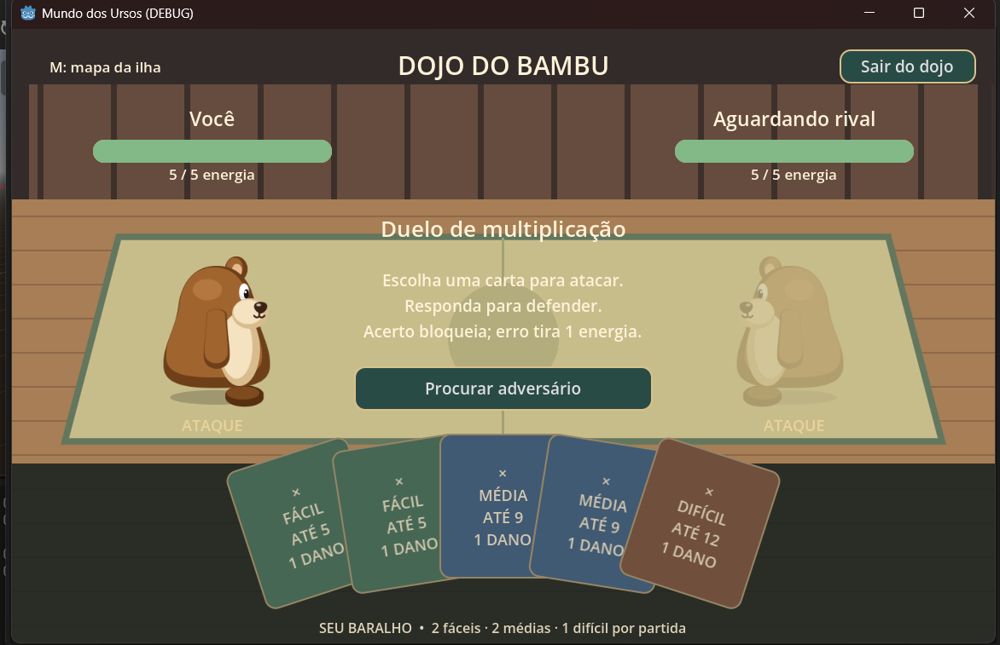

# 🐻 Mundo dos Ursos — Hackathon LEPV

> Mundo social online 2D em que aprender gera conquistas, moedas e novas formas de se expressar entre amigos.

**Status:** início da implementação da pessoa 1: lobby provisório, movimento em quatro direções e rede WebSocket. Os demais sistemas abaixo descrevem o escopo planejado.

**Tecnologias:** Godot **4.7.2** (versão informada), GDScript e arte em produção no Inkscape.
**Nome do jogo:** provisório.

**Executar:** importar `project.godot` e pressionar F5. Criar uma sala na primeira janela e entrar na segunda com `ws://127.0.0.1:9080`. Veja [desenvolvimento e testes](docs/DESENVOLVIMENTO.md) e o [padrão dos exports do urso](assets/characters/brown/README.md).

**Novo:** duelo matemático 1x1 com fila, cartas, multiplicação, energia e resultado. [Como jogar e integrar a arte do dojo](docs/DUELO_MATEMATICO.md).

## Cena de cartas

Captura enviada pelo usuário da versão atual do dojo.



## Índice

- [Visão do produto](#visão-do-produto)
- [Escopo do protótipo](#escopo-do-protótipo)
- [Mundo, personagens e progressão](#mundo-personagens-e-progressão)
- [Os três minijogos](#os-três-minijogos)
- [Divisão entre quatro pessoas](#divisão-entre-quatro-pessoas)
- [Passo a passo de desenvolvimento](#passo-a-passo-de-desenvolvimento)
- [Integração e arquitetura](#integração-e-arquitetura)
- [Desenvolvimento com IA e MCP](#desenvolvimento-com-ia-e-mcp)
- [Economia e precificação](#economia-e-precificação)
- [Critérios de conclusão](#critérios-de-conclusão)
- [Decisões pendentes](#decisões-pendentes)

## Visão do produto

A inspiração é a experiência social de mundos como Club Penguin: encontrar amigos, explorar espaços, jogar e exibir uma identidade própria. Personagens, cenários e assets devem ter identidade original.

O ciclo central é:

**Encontrar amigos → escolher uma missão → jogar e aprender → ganhar moedas e selos → personalizar o urso → voltar ao lobby e mostrar.**

A hipótese de engajamento é que itens visíveis e conquistas compartilhadas motivem o retorno. A hipótese de negócio é que responsáveis aceitem uma assinatura que amplie a personalização em uma experiência divertida com progresso de aprendizagem perceptível. Ambas precisam de validação.

## Escopo do protótipo

| Elemento | Entrega inicial |
|---|---|
| Plataforma | Navegador, com salas pequenas |
| Personagem gratuito | Urso marrom |
| Assinatura demonstrativa | Variante panda e cosméticos exclusivos |
| Direções | Frente, costas, esquerda e direita |
| Pet | Peixe voador com capacete ou bacia de água |
| Toca pessoal | Uma toca por urso, editável com móveis e decoração; amigos podem visitar |
| Matemática | Duelo online 1x1 com cartas |
| Português | Barco com perguntas e obstáculos |
| Ciências | Foguete de tronco com meteoros, combustível e perguntas |
| Mundo | Lobby, bosque panda, porto polar, área do tronco-foguete e área comercial |
| Lojas | Uma de cosméticos e uma de pets |
| Progressão | Moedas, inventário, selos e missões diárias |
| Interação social | Jogadores visíveis, apelidos e emotes predefinidos |
| Persistência | Perfil, saldo, conquistas e itens equipados recuperados ao reconectar |

O lobby e o duelo são multiplayer. Barco e foguete começam como experiências individuais conectadas ao mesmo perfil.

A assinatura deve estar identificada como **simulação no protótipo**. Cobrança real é uma etapa posterior.

## Mundo, personagens e progressão

### Mapa

| Área | Identidade | Função |
|---|---|---|
| Lobby | Praça dos ursos | Encontro, emotes, missões e acessos |
| Bosque panda | Bambu e arena original | Duelo matemático |
| Porto polar | Neve, gelo e barcos | Minijogo de português |
| Clareira do foguete | Tronco oco preparado para decolar | Entrada do minijogo de ciências |
| Área comercial | Duas lojas identificáveis | Cosméticos e pets |

No acesso ao foguete, o urso entra no buraco do tronco e uma animação curta mostra a decolagem.

### Personagens e arte

- Urso marrom como base gratuita.
- Panda como primeira variante de assinatura.
- Sprites nas quatro direções; movimento troca a imagem conforme a direção.
- Mesmo tamanho de tela, posição dos pés e pontos de encaixe em todas as variantes.
- Roupas e acessórios acompanham a direção do personagem.
- Pet segue o urso; primeira versão com um peixe e um recipiente de água.
- Variações de peixes e novos cosméticos entram após o ciclo principal funcionar.
- SVGs editáveis no Inkscape e exports padronizados para o Godot.

### Toca personalizável

**Cada urso tem sua própria toca editável:** um espaço pessoal para decorar, guardar a identidade do jogador e receber amigos.

- Todo jogador recebe uma toca básica gratuita.
- No modo de edição, o dono pode posicionar, mover e remover móveis e decorações.
- Itens removidos voltam ao inventário.
- A decoração e as posições ficam salvas ao sair e reconectar.
- Amigos podem visitar com autorização do dono; apenas o proprietário pode editar.
- Móveis e enfeites podem ser comprados com moedas ou conquistados em missões e selos.
- A loja de cosméticos inclui uma categoria de decoração.
- Coleções temáticas para assinantes são uma hipótese de monetização, mantendo a edição básica gratuita.

**Primeira versão:** um cômodo, posicionamento em grade e poucos itens, como cama, tapete, luminária e troféu. Expansões de cômodos ficam para depois.

**Ciclo social:** jogar → conquistar uma decoração → editar a toca → convidar um amigo para conhecer.

### Progressão

| Sistema | Papel |
|---|---|
| Moedas | Comprar itens gratuitos e pets |
| Selos | Registrar conquistas específicas |
| Domínio | Reconhecer aprendizagem em desafios novos |
| Exploração | Liberar cenários ou elementos conforme o progresso |
| Missão diária | Dar um objetivo curto para a sessão |
| Assinatura | Ampliar expressão visual sem vantagem competitiva |

Exemplos de selos: primeira partida concluída, explorador dos três jogos e domínio inicial de multiplicação. Critérios de domínio devem exigir questões variadas, não apenas repetir a mesma resposta.

Primeira missão diária sugerida: concluir uma sessão de um minijogo. Cada missão pode conceder sua recompensa uma única vez por dia, usando a data definida pelo servidor.

## Os três minijogos

### 1. Duelo matemático — 1x1

**Cenário:** habitat do panda.  
**Conceito:** jogadores usam cartas com problemas para atacar; o adversário responde para defender.

Regras iniciais propostas para teste:

1. Cada jogador começa com 5 pontos de energia.
2. O jogador da vez escolhe uma carta fácil, média ou difícil.
3. O servidor seleciona uma questão do tema e da dificuldade.
4. O adversário responde.
5. Acerto bloqueia o ataque; erro reduz a energia e mostra uma explicação.
6. O turno passa ao outro jogador.
7. A partida termina por energia ou limite de rodadas, com regra explícita de empate.

Começar com dano igual e quantidade limitada de cartas por dificuldade. Alterações de dano e tempo de resposta dependem de testes.

**Primeiro tema:** escolher multiplicação ou soma de frações.  
**Estados:** aguardando jogadores → seleção de carta → resposta → resolução → próximo turno ou resultado.

O servidor controla turnos, questões, validação das respostas e resultado. A resposta correta não deve ser enviada ao cliente antes da resolução.

### 2. Barco de português

**Cenário:** habitat do urso polar.  
**Conceito:** acertos fazem o barco avançar; erros provocam obstáculos.

1. O barco chega a um ponto de pergunta.
2. A ação pausa para leitura de um texto curto.
3. O jogador escolhe a resposta.
4. Acerto produz um impulso.
5. Erro provoca uma animação de iceberg ou outro obstáculo e uma penalidade pequena.
6. O jogo apresenta a explicação.
7. A viagem continua até o destino ou o fim das condições da fase.

Começar com interpretação de textos curtos e uma única rota. Durante a pergunta, a ação permanece pausada para que leitura e desvio de obstáculos não disputem atenção.

### 3. Foguete de ciências

**Cenário:** foguete feito de tronco.  
**Conceito:** desviar de meteoros, coletar moedas e responder perguntas para recuperar combustível.

1. O urso entra no tronco e decola.
2. O jogador controla o foguete e desvia dos obstáculos.
3. O combustível diminui com o tempo.
4. Cápsulas de combustível abrem uma pergunta e pausam a ação.
5. Acerto recupera mais combustível.
6. Erro mostra a explicação e concede recuperação menor.
7. O jogador coleta moedas durante o percurso.
8. A sessão termina ao chegar ao destino ou acabar o combustível.

Os conteúdos podem incluir biologia, física e química, sempre adequados ao ano escolar escolhido. Começar com um conjunto pequeno e coerente de conhecimentos gerais.

## Divisão entre quatro pessoas

Os nomes serão preenchidos pelo grupo.

| Pessoa | Frente | Responsabilidade | Entrega verificável |
|---|---|---|---|
| **1** | Mundo e integração | Godot, rede, mapas, movimento, perfil, persistência, inventário e lógica das lojas | Dois jogadores se encontram e veem os itens equipados um do outro |
| **2** | Matemática | Deck, perguntas, turnos, combate e integração do duelo | Dois jogadores concluem uma partida com resultado consistente |
| **3** | Português e ciências | Barco, foguete, obstáculos, perguntas e resultados | Ambos os jogos iniciam, terminam e retornam ao lobby |
| **4** | Arte, economia e produto | Inkscape, assets, catálogo, preços, assinatura, validação e apresentação | Arte consistente e proposta de monetização com custos e hipóteses explícitos |

### Pessoa 1 — Mundo e integração

- [x] Fixar a versão do Godot e criar o projeto (4.7.2).
- [x] Criar o lobby com arte provisória.
- [ ] Implementar movimento e quatro direções.
- [ ] Conectar dois clientes à mesma sala.
- [ ] Sincronizar posição, direção, aparência e emotes.
- [x] Criar portais e retorno dos minijogos (cenas provisórias; jogos ainda pendentes).
- [ ] Implementar perfil, saldo, inventário e persistência.
- [ ] Implementar lojas com o catálogo da pessoa 4.
- [ ] Implementar toca pessoal, editor em grade, visitas e salvamento da decoração.
- [ ] Validar no servidor propriedade dos itens e permissão de edição da toca.
- [ ] Integrar resultados, selos e missões diárias.
- [ ] Preparar o acesso à versão publicada.

### Pessoa 2 — Duelo matemático

- [ ] Construir primeiro uma partida local.
- [ ] Implementar cartas e quantidade por dificuldade.
- [ ] Ler questões de um banco padronizado.
- [ ] Implementar turnos, energia, feedback e empate.
- [ ] Integrar a partida à rede com a pessoa 1.
- [ ] Tratar desconexão e ações fora do turno.
- [ ] Aplicar animações de ataque, defesa e comemoração.
- [ ] Emitir o resultado para o sistema central.

### Pessoa 3 — Barco e foguete

- [ ] Implementar o barco com formas provisórias.
- [ ] Conectar perguntas, avanço, obstáculos e feedback.
- [ ] Concluir o fluxo de entrada, resultado e retorno.
- [ ] Implementar o foguete com meteoros e combustível.
- [ ] Adicionar cápsulas, perguntas pausadas e moedas.
- [ ] Integrar a animação de decolagem.
- [ ] Emitir resultados no mesmo formato do duelo.
- [ ] Ajustar duração e dificuldade após testes.

### Pessoa 4 — Arte, economia e produto

- [ ] Definir paleta, proporções e padrão dos assets.
- [ ] Criar urso marrom nas quatro direções.
- [ ] Criar panda e um acessório nas mesmas proporções.
- [ ] Criar pet e elementos visuais dos cenários.
- [ ] Criar cartas, ícones de moedas, selos e botões.
- [ ] Definir catálogo e preços em moedas.
- [ ] Criar o interior da toca e os primeiros móveis e enfeites.
- [ ] Definir preços de decoração e opções gratuitas e de assinatura.
- [ ] Calcular tempo estimado para conquistar cada item.
- [ ] Definir benefícios e três hipóteses de preço da assinatura.
- [ ] Estimar custos fixos e variáveis.
- [ ] Validar a proposta com jogadores e responsáveis.
- [ ] Preparar apresentação e roteiro de demonstração.

**Divisão da loja:** pessoa 1 implementa compra, saldo e inventário; pessoa 4 entrega catálogo, imagens, preços e regras.

**Revisão pedagógica:** pessoas 2 e 3 revisam suas questões; pessoa 4 coordena uma segunda leitura humana antes da demonstração.

## Passo a passo de desenvolvimento

### Etapa 0 — Alinhamento e preparação

- Escolher faixa etária e ano escolar.
- Confirmar navegador como plataforma inicial.
- Fixar versão do Godot, convenções e pastas.
- Testar as capacidades reais dos servidores MCP escolhidos.
- Definir formato das questões, resultados e itens.
- Atribuir as quatro frentes aos integrantes.

**Pronto quando:** todos abrem o mesmo projeto e conseguem executar uma cena simples.

### Etapa 1 — Provar o ciclo social

1. Pessoa 1 conecta dois jogadores no lobby.
2. Pessoa 2 cria uma partida matemática mínima.
3. Pessoa 3 constrói a primeira versão do barco.
4. Pessoa 4 produz um urso e um acessório, além da primeira tabela de preços.
5. Integrar: partida → recompensa → compra → equipar → outro jogador vê.

**Pronto quando:** o ciclo completo funciona em dois clientes, mesmo com arte provisória.

### Etapa 2 — Completar o protótipo

1. Finalizar os três minijogos.
2. Adicionar os destinos e as duas lojas.
3. Integrar pet, panda, selos e missão diária.
4. Implementar toca editável e visitas; persistir progresso, itens e decoração.
5. Adicionar feedback pedagógico às perguntas.
6. Aplicar a identidade visual.

**Pronto quando:** todos os jogos retornam ao lobby e compartilham o mesmo perfil.

### Etapa 3 — Validar e apresentar

1. Testar em dois computadores.
2. Corrigir conexão, turnos, compras e recompensas.
3. Observar entendimento das perguntas e vontade de voltar.
4. Ajustar preços em moedas e duração das sessões.
5. Finalizar hipótese de assinatura e custos.
6. Gravar ou ensaiar a demonstração completa.
7. Registrar instruções reais de instalação e execução quando o código existir.

## Integração e arquitetura

### Contratos compartilhados

| Objeto | Campos mínimos |
|---|---|
| Questão | ID, matéria, tema, dificuldade, enunciado, alternativas, resposta correta, explicação |
| Resultado | ID da sessão, jogo, acertos, tentativas, conclusão, habilidades praticadas |
| Item | ID, categoria, preço, requisito de assinatura, requisito de selo, assets por direção |
| Perfil | ID do jogador, apelido, aparência, saldo, inventário, itens equipados, selos, missões |
| Toca | ID, proprietário, tema, permissão de visita e itens posicionados com ID de instância, item e coordenadas |

O banco completo contém a resposta correta; a mensagem enviada ao jogador durante a pergunta contém apenas os campos públicos.

### Regras de integração

- Os minijogos informam resultados; o sistema central valida e concede recompensas.
- Cada sessão só pode ser recompensada uma vez.
- Compras validam saldo e requisitos no servidor.
- Edições da toca validam proprietário, itens disponíveis e posições permitidas; visitantes não podem editar.
- O servidor controla o duelo e a data das missões diárias.
- Resultados dos jogos individuais precisam de validação antes de alterar saldo.
- Desconexões e empates têm tratamento explícito.
- Pessoa 1 mantém configurações e cenas compartilhadas.
- Cada integrante trabalha em sua área e integra mudanças pequenas.

### Estrutura sugerida para implementação futura

```text
assets/
  source/           # SVGs editáveis
  characters/
  cosmetics/
  pets/
  environments/
  ui/
scenes/
  world/
  player/
  minigames/
    math/
    language/
    science/
  shops/
scripts/
  core/
  network/
  progression/
data/
  questions/
  items/
  achievements/
  missions/
```

Essa estrutura é o alvo de organização. A etapa inicial já criou jogador, praça,
rede e contrato dos exports do urso; as pastas dos demais sistemas serão
adicionadas conforme a implementação. Veja [os testes executados](docs/TESTES.md).

### Rede

Para navegador, usar WebSocket/WSS como ponto de partida. A exportação web não dispõe do transporte UDP usado pelo ENet.

- [Multiplayer no Godot](https://docs.godotengine.org/en/4.7/tutorials/networking/high_level_multiplayer.html)
- [Demonstração oficial de multiplayer WebSocket](https://godotengine.org/asset-library/asset/2801)

Verificar a documentação correspondente à versão que a equipe instalar.

## Desenvolvimento com IA e MCP

### Preparação

1. Selecionar e revisar os servidores MCP disponíveis para Godot e Inkscape.
2. Confirmar compatibilidade com as versões instaladas.
3. Testar leitura do projeto, criação de uma cena, execução e captura dos erros.
4. Confirmar edição de SVG e exportação de assets.
5. Se uma operação não estiver disponível via MCP, usar os arquivos do projeto e a CLI adequada.
6. Cada integrante trabalha em sua cópia/branch para evitar edições concorrentes na mesma cena.

A conexão MCP não está configurada por este documento. Suas capacidades dependem da implementação escolhida.

O Inkscape permite exportações por linha de comando: [documentação oficial](https://wiki.inkscape.org/wiki/Using_the_Command_Line).

### Ciclo de trabalho

**Tarefa pequena → IA inspeciona → implementa → pessoa executa → devolve erros e imagens → IA corrige → salvar versão funcionando.**

Usar IA para preparar questões durante o desenvolvimento e revisar cada resposta antes de incluí-la no banco. O protótipo pode funcionar sem chamadas a modelos durante as partidas.

### Prompt comum

> Inspecione o projeto antes de editar. Implemente apenas a tarefa descrita, respeitando a versão do Godot e os contratos existentes. Liste os arquivos alterados e como verificar o resultado. Não altere áreas de outros integrantes sem explicar a dependência. Não declare testes como executados se não os executou.

### Prompt da pessoa 1

> Crie primeiro um lobby mínimo no Godot para navegador com dois clientes conectados por WebSocket, movimento e quatro direções visuais. Use arte provisória e separe jogador, sala e rede. Mostre como testar com dois clientes antes de adicionar inventário e lojas.

### Prompt da pessoa 2

> Crie um duelo matemático por turnos em uma cena isolada. Use estados explícitos para seleção de carta, resposta, resolução e fim. Leia perguntas do formato combinado. Comece localmente e separe a integração de rede. Trate empate, desconexão e tentativa de ação fora do turno.

### Prompt da pessoa 3

> Crie barco de português e foguete de ciências em cenas independentes. Ambos leem o mesmo formato de questões e emitem o mesmo formato de resultado. Comece pelo barco com formas provisórias. Pause a ação durante perguntas. Conclua início, resultado e retorno antes de implementar o foguete.

### Prompt da pessoa 4

> Defina uma identidade vetorial original para um mundo de ursos: paleta, proporções, quatro direções e encaixes dos acessórios. Prepare SVGs editáveis. Proponha catálogo, preços em moedas e sessões necessárias para cada compra. Separe hipóteses de fatos; não invente dados de mercado.

## Economia e precificação

**Responsável: pessoa 4.** Valores abaixo são hipóteses para testar, não preços validados.

### Três fontes de valor dos itens

| Tipo | Aquisição | Significado social |
|---|---|---|
| Estilo | Moedas ou assinatura | Expressar preferências |
| Conquista | Domínio e desafios | Mostrar algo que conseguiu fazer |
| Memória coletiva | Eventos e missões em grupo | Registrar participação com amigos |

Pagamento não aumenta dano, acertos, pontuação ou chances de vitória. Alguns itens desejáveis devem continuar disponíveis por conquista.

### Economia inicial em moedas

| Evento ou item | Valor inicial de teste |
|---|---:|
| Partida concluída | +20 moedas |
| Bônus de aprendizagem | Até +10 moedas |
| Acessório básico | 100 moedas |
| Roupa especial | 300 moedas |
| Pet | 500 moedas |

Um acessório básico exigiria aproximadamente quatro ou cinco partidas. Medir se o esforço é agradável e ajustar antes de aumentar o catálogo.

Moedas coletadas no foguete devem entrar na mesma política de recompensas, com limites explícitos, para evitar que um jogo torne os demais irrelevantes.

### Assinatura

Benefícios iniciais propostos:

- Variante panda.
- Cosméticos exclusivos.
- Variações visuais de pets.
- Coleções temáticas de móveis e decoração para a toca, como hipótese a validar.
- Futuras opções adicionais de personalização.

Aprendizagem principal, conquistas e competição permanecem acessíveis sem vantagem paga.

A equipe deve definir o comportamento após cancelamento. Hipótese inicial: itens permanecem registrados, mas benefícios exclusivos exigem assinatura ativa para uso. Comunicar a regra claramente.

### Trabalho de precificação

- [ ] Propor três preços mensais para pesquisa com responsáveis.
- [ ] Estimar jogadores ativos e proporção de assinantes em cenários conservador, intermediário e otimista.
- [ ] Levantar hospedagem, armazenamento, tráfego e taxas de pagamento.
- [ ] Incluir produção de conteúdo e suporte.
- [ ] Separar custo da IA usada no desenvolvimento de eventual IA em produção.
- [ ] Calcular contribuição e ponto de equilíbrio.
- [ ] Testar se o valor percebido sustenta a renovação.

**Contribuição por assinante = receita líquida da assinatura − custo variável por assinante.**

**Resultado mensal estimado = contribuição total dos assinantes − custo dos usuários gratuitos − custos fixos.**

Não assumir que toda criança interessada converterá em assinatura.

### Métricas para o primeiro teste

- Jogadores que completam a primeira missão.
- Jogadores que querem retornar em outro dia.
- Acertos em questões novas sobre o conteúdo praticado.
- Tempo até a primeira compra com moedas.
- Itens que despertam interesse ao serem vistos em outro jogador.
- Interesse do responsável em pagar e motivo da decisão.

## Critérios de conclusão

### Checklist funcional

- [ ] Dois jogadores acessam o mesmo lobby.
- [ ] Movimento e direção aparecem corretamente para ambos.
- [ ] Duelo 1x1 mantém turnos e resultado consistentes.
- [ ] Barco e foguete podem ser concluídos.
- [ ] Perguntas têm respostas e explicações revisadas.
- [ ] Recompensas não são concedidas duas vezes para a mesma sessão.
- [ ] Loja impede compra sem saldo.
- [ ] Acessório equipado fica visível para o outro jogador.
- [ ] Pet acompanha o personagem.
- [ ] Cada jogador acessa sua própria toca e posiciona, move e remove decorações.
- [ ] Decoração permanece após reconexão.
- [ ] Um amigo autorizado visita e vê a toca; visitantes não conseguem editar.
- [ ] Missão diária e pelo menos um selo funcionam.
- [ ] Progresso permanece após reconexão.
- [ ] Assinatura simulada está identificada.
- [ ] Hipóteses de preços e custos estão documentadas.

### Roteiro da demonstração

1. Dois colegas entram na praça.
2. Um convida o outro para o duelo matemático.
3. Eles jogam e recebem o resultado.
4. Um compra e equipa um acessório.
5. O outro vê a mudança no lobby.
6. O grupo demonstra o barco.
7. O urso entra no tronco, decola e joga ciências.
8. Um selo ou missão é concluído.
9. Um jogador decora sua toca e recebe o colega para uma visita.
10. A loja apresenta o panda, opções de decoração e a assinatura demonstrativa.

## Decisões pendentes

- [ ] Nome definitivo e identidade do jogo.
- [ ] Nomes dos responsáveis pelas quatro frentes.
- [ ] Faixa etária e ano escolar.
- [x] Versão do Godot: 4.7.2, informada pelo usuário e usada nos testes locais.
- [ ] Servidores MCP específicos para Godot e Inkscape (a etapa inicial usa arquivos e CLI).
- [ ] Tema inicial do duelo.
- [ ] Regras finais de dano, rodadas e empate.
- [ ] Conteúdos iniciais de português e ciências.
- [ ] Requisitos de desbloqueio dos cenários.
- [ ] Modelo de perfil e recuperação de acesso.
- [ ] Hospedagem da demonstração.
- [ ] Preço e regras finais da assinatura.
- [ ] Conferência das entregas e dos prazos no regulamento oficial.

---

**Prioridade de execução:** provar cedo o ciclo jogar → conquistar → equipar → mostrar para um amigo.
